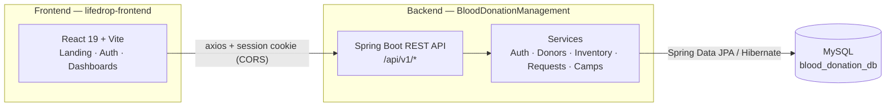

<div align="center">



# LifeDrop

A full-stack blood donation management system. Donors register and track their eligibility, receivers (hospitals and patients) raise blood requests, and admins manage live inventory for all 8 blood groups along with donation camps.

[](https://react.dev)
[](https://vite.dev)
[](https://spring.io/projects/spring-boot)
[](https://openjdk.org)
[](https://www.mysql.com)
[](LICENSE)

[Features](#features) · [Architecture](#architecture) · [API](#api) · [Getting started](#getting-started)

</div>

## Why

India faces a shortage of over a million units of blood every year, and patients routinely struggle to find the right blood group at the right time. LifeDrop keeps inventory visible in real time and gives hospitals a fast request path, so the blood that exists gets found and used.

## Features

- **Three user roles.** Donor, receiver, and admin, each with a dedicated dashboard and role-protected routes.
- **Live blood inventory.** Unit counts for all 8 blood groups, shown publicly on the landing page and updated as requests are fulfilled.
- **Request workflow.** Blood requests move through `PENDING → APPROVED → FULFILLED`; fulfilling a request deducts units from inventory.
- **90-day eligibility rule.** Donors cannot record a new donation within 90 days of their last one.
- **Donation camps.** Admins schedule camps; upcoming ones are listed publicly with a live active-camp count.
- **Session-based auth.** Cookie sessions with CORS scoped to the frontend origin. No extra auth dependencies.
- **Animated landing page.** ECG monitor line, falling drops, heartbeat pulses, and scroll-reveal transitions, all written in plain CSS.

## Architecture



## API

Base URL: `http://localhost:8080/api/v1`. Auth is cookie-based, so cross-origin requests need `withCredentials`.

| Module | Endpoint | Method | Description |
|---|---|---|---|
| Auth | `/auth/register` | `POST` | Create a donor, receiver, or admin account |
| Auth | `/auth/login`, `/auth/logout` | `POST` | Session login and logout |
| Auth | `/auth/me` | `GET` | Current authenticated user |
| Donors | `/donors` | `GET` | List donors |
| Donors | `/donors` | `POST` | Register a donor |
| Donors | `/donors/{id}` | `GET`, `PUT`, `DELETE` | Fetch, update, or remove a donor |
| Donors | `/donors/count` | `GET` | Total registered donors |
| Donors | `/donors/{id}/eligibility` | `GET` | 90-day eligibility check |
| Donors | `/donors/{id}/donate` | `POST` | Record a donation, sets last-donation date |
| Inventory | `/inventory` | `GET` | Stock levels for all blood groups |
| Inventory | `/inventory/total` | `GET` | Total units available |
| Inventory | `/inventory/{bloodGroup}` | `GET` | Stock for one blood group |
| Inventory | `/inventory/add` | `POST` | Add units |
| Inventory | `/inventory/initialize` | `POST` | Seed rows for all 8 groups |
| Requests | `/requests` | `POST` | Raise a blood request |
| Requests | `/requests/pending` | `GET` | Requests awaiting admin approval |
| Requests | `/requests/{id}` | `GET`, `DELETE` | Fetch or cancel a request |
| Requests | `/requests/{id}/approve` | `PUT` | Approve a request |
| Requests | `/requests/{id}/fulfill` | `PUT` | Fulfil a request and deduct units |
| Requests | `/requests/receiver/{receiverId}` | `GET` | A receiver's own requests |
| Requests | `/requests/count/pending` | `GET` | Pending request count |
| Camps | `/camps`, `/camps/upcoming` | `GET` | All / upcoming donation camps |
| Camps | `/camps` | `POST` | Create a donation camp |
| Camps | `/camps/{id}` | `GET`, `PUT`, `DELETE` | Fetch, reschedule, or cancel a camp |
| Camps | `/camps/count/active` | `GET` | Active camp count |

## Getting started

Requires Node.js 20.19+ (or 22.12+), JDK 17, and MySQL 8 running locally.

Create the schema (Hibernate creates the tables on startup):

```sql
CREATE DATABASE blood_donation_db;
```

Start the backend:

```bash
cd BloodDonationManagement

# Windows
mvnw.cmd spring-boot:run

# macOS / Linux
./mvnw spring-boot:run
```

The API starts on `http://localhost:8080`. If your MySQL credentials are not the default `root`/`root`, set `DB_USERNAME`/`DB_PASSWORD` (see [Configuration](#configuration)).

In a second terminal, start the frontend:

```bash
cd lifedrop-frontend
npm install
npm run dev
```

The app runs at `http://localhost:5173`.

## Configuration

Backend settings live in `BloodDonationManagement/src/main/resources/application.properties`.

| Property | Default | Purpose |
|---|---|---|
| `server.port` | `8080` | Backend port |
| `spring.datasource.url` | `jdbc:mysql://localhost:3306/blood_donation_db` | Database connection |
| `DB_USERNAME` / `DB_PASSWORD` | `root` / `root` | Database credentials (environment overrides) |
| `app.cors.allowed-origins` | `http://localhost:5173` | Frontend origin allowed by CORS |
| `app.donation.eligibility.days` | `90` | Minimum days between donations |

## License

Released under the [MIT License](LICENSE).
